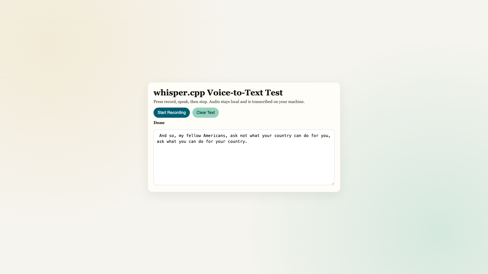

# thought-capture

Private, offline voice capture. A small browser page records your voice and transcribes it on your own machine with [whisper.cpp](https://github.com/ggml-org/whisper.cpp) and the `large-v3-turbo` model, so no audio ever leaves the computer. Alongside it is an Android app with a home-screen widget: tap once to start dictating, tap again to stop, and every recognised sentence is appended with a timestamp to a plain-text `thoughts.txt` in a folder you choose. The app grew into a small task and project organiser built on the same folder.



*The transcript above is whisper.cpp's own public-domain `jfk.wav` sample, run through the page's upload path.*

## Features

- **Local speech-to-text in the browser.** Press record, speak, press stop; the clip goes to `whisper-server` on `127.0.0.1` and the text appears in the box. Nothing is sent anywhere else.
- **One launcher.** `run_demo.sh` starts `whisper-server` with the page as its static root; host, port, model and language can be overridden from the environment.
- **Android widget for quick capture.** A foreground service listens with Android's `SpeechRecognizer` and appends each utterance to `thoughts.txt`.
- **Your folder, your files.** Choose any folder with the system folder picker (a synced folder works well). Until you do, everything stays in the app's private storage. The app never talks to a server.
- **Organiser on plain files.** Tasks in a todo.txt-style file (`@context`, `+project`, `#area`, `due:`), projects as Markdown files, notes, goals, milestones and areas of focus as small JSON files, with work, focus, low-energy and review modes.

## Run the browser demo

Requirements: a C/C++ toolchain, CMake, `ffmpeg` on your `PATH`, and about 600 MB for the model.

### Build whisper.cpp

whisper.cpp is not vendored. Clone and build it into `third_party/` (the demo was made with commit `30c5194c`, but current `master` should work):

```sh
git clone https://github.com/ggml-org/whisper.cpp third_party/whisper.cpp
cmake -S third_party/whisper.cpp -B third_party/whisper.cpp/build -DCMAKE_BUILD_TYPE=Release
cmake --build third_party/whisper.cpp/build -j --target whisper-server
```

### Download the model

```sh
sh third_party/whisper.cpp/models/download-ggml-model.sh large-v3-turbo-q5_0
```

### Start it

```sh
./run_demo.sh                      # then open http://127.0.0.1:5001
PORT=5050 ./run_demo.sh            # another port
MODEL=third_party/whisper.cpp/models/ggml-base.en.bin ./run_demo.sh   # a smaller model
```

The browser asks for microphone permission the first time. The launcher forces CPU mode (`-ng`) for reliability; remove that flag to use the GPU.

| Variable | Default |
|---|---|
| `WHISPER_DIR` | `third_party/whisper.cpp` |
| `WHISPER_SERVER` | `$WHISPER_DIR/build/bin/whisper-server` |
| `MODEL` | `$WHISPER_DIR/models/ggml-large-v3-turbo-q5_0.bin` |
| `HOST` / `PORT` | `127.0.0.1` / `5001` |
| `LANGUAGE` | `en` |
| `PUBLIC_DIR` | `public` |

## Build the Android app

The app lives in `android-thought-capture/` (Kotlin, Android 8.0+ / API 26, targets API 35). Open that folder in Android Studio, or build from the command line with JDK 17 and the Android SDK installed:

```sh
cd android-thought-capture
echo "sdk.dir=/path/to/Android/sdk" > local.properties
./gradlew assembleDebug
adb install -r app/build/outputs/apk/debug/app-debug.apk
```

`scripts/env.sh` is an optional helper for a toolchain installed inside this repository (`.tools/jdk`, `android-sdk/`, `.gradle-home/`); skip it if you use Android Studio's SDK.

Then add the widget to a home screen, grant microphone and notification permissions, and pick a save folder in **Settings → Choose Save Folder**. If the folder you pick contains a subfolder named `Face Dragons` (the app's name), the app uses that subfolder; otherwise it uses the folder itself.

Notes:

- Android widgets cannot do true press-and-hold recording, so the widget is a toggle: tap to start, tap again to stop. A notification shows while it is listening.
- Speech recognition on the phone uses whatever recogniser the device provides; whisper.cpp is used by the browser demo only.

## Layout

```
public/index.html            the recording page (vanilla JS, MediaRecorder -> /inference)
run_demo.sh                  starts whisper-server with the page as its static root
android-thought-capture/     the Android app and widget
third_party/                 whisper.cpp clone and model (not committed)
```

## Tech

whisper.cpp (`whisper-server`, ggml `large-v3-turbo` q5_0), plain HTML and JavaScript, ffmpeg for audio conversion. Android: Kotlin, `SpeechRecognizer`, a foreground service, an App Widget, and the Storage Access Framework for the save folder.

## Licence

MIT for the code in this repository; see [LICENSE](LICENSE). whisper.cpp and the Whisper models carry their own MIT licences.
